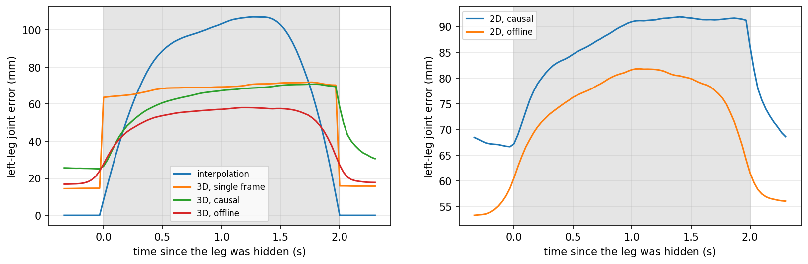

# Human Dynamics From Motion

**Predicting ground reaction forces and lower-limb joint torques from 3D human motion using PyTorch, SMPL-H, inverse dynamics, and temporal convolutional networks.**

This project learns human dynamics directly from 3D motion. Given root-relative 3D joint trajectories, the model predicts bilateral ground reaction forces and ankle, knee, and hip joint torques over time.

The pipeline combines biomechanical target construction with learned temporal dynamics. It includes SMPL-H kinematics, force-plate calibration, motion-force synchronization, recursive inverse dynamics, physics-aware training, occlusion-robust learning, and leave-one-subject-out evaluation.

<p align="center">
  
</p>

## Overview

The model input contains 22 body joints represented by 3D positions and finite-difference velocities.

```text
22 joints x 3 position coordinates = 66
22 joints x 3 velocity coordinates = 66
Total input channels              = 132
```

At each frame, the network predicts:

```text
Left and right 3D ground reaction force     = 6 values
Bilateral ankle, knee, and hip 3D moments   = 18 values
Total output channels                        = 24
```

The end-to-end workflow is:

```text
GroundLink force plates + MoSh++ motion fits
                    |
                    v
          SMPL-H body reconstruction
                    |
                    v
        subject-specific calibration
                    |
                    v
        force and motion alignment
                    |
                    v
         recursive inverse dynamics
                    |
                    v
       3D joint position + velocity
                    |
                    v
          Temporal ConvNet
                    |
                    v
   ground forces + lower-limb joint torques
```

The processed benchmark contains **336 force-plate trials from 7 subjects**. Across the processed trials, **87.4 percent of frames** pass the inverse-dynamics force-consistency filter.

## Main results

Evaluation uses leave-one-subject-out cross-validation. Each subject is held out once, and target normalization is recomputed using only the remaining six subjects.

| Model | Vertical GRF RMSE, BW | Ankle RMSE, N m/kg | Knee RMSE, N m/kg | Hip RMSE, N m/kg | Force-balance error, BW |
| --- | ---: | ---: | ---: | ---: | ---: |
| Training mean | 0.322 | 0.286 | 0.415 | 0.425 | 0.312 |
| Single frame | 0.114 | 0.136 | 0.162 | 0.144 | 0.244 |
| Temporal ConvNet | **0.082** | 0.120 | **0.155** | **0.139** | 0.167 |
| Temporal ConvNet + force-balance loss | **0.079** | **0.119** | 0.157 | **0.139** | **0.087** |
| Temporal ConvNet, corruption-trained | 0.107 | 0.148 | 0.197 | 0.170 | 0.192 |

The standard temporal model reaches mean correlations of:

- **0.904** for ankle torque
- **0.918** for knee torque
- **0.963** for hip torque

The temporal model improves vertical GRF and ankle RMSE on all 7 held-out subjects relative to the single-frame baseline.

The force-balance model reduces mean physics violation from **0.167 BW to 0.087 BW**, a reduction of about **48 percent**, while preserving the overall prediction accuracy.

<p align="center">
  
</p>

Grey regions in the example indicate frames rejected by the inverse-dynamics validity filter.

## Occlusion and noise robustness

Real motion capture and vision-based tracking systems can lose joints because of self-occlusion, motion blur, truncation, or crowding. To test this failure mode, a second temporal model is trained with random joint dropout, structured lower-limb dropout, and 3D position noise.

This model sacrifices some clean-input accuracy for substantially stronger robustness under corrupted observations.

| Test condition | Standard temporal, GRF RMSE | Corruption-trained, GRF RMSE |
| --- | ---: | ---: |
| Clean | 0.082 BW | 0.107 BW |
| Both feet hidden | 0.331 BW | **0.152 BW** |
| Lower legs hidden | 0.324 BW | **0.219 BW** |
| 25 mm joint noise | 0.351 BW | **0.113 BW** |

With both feet hidden, corruption training reduces vertical-force error from **0.331 BW to 0.152 BW**. Under the same condition, hip torque RMSE remains at **0.196 N m/kg** instead of increasing to **0.398 N m/kg**.

<p align="center">
  
</p>

## Force and torque architecture study

Ablations test whether torque prediction improves when force is explicitly routed into the torque estimator.

Across the 7 held-out subjects:

- shared force and torque heads produce **0.082 BW** vertical GRF RMSE
- a force-then-torque cascade also produces **0.082 BW** vertical GRF RMSE and does not consistently improve torque prediction
- a torque-only network remains competitive with the shared model
- measured force, used as an upper-bound input, improves mean ankle, knee, and hip torque RMSE by about **12.0 percent**, **9.9 percent**, and **11.7 percent**

These experiments suggest that force is valuable as a prediction target and as a physical regularizer, but explicitly feeding force into the torque head is not the primary source of torque accuracy.

## Physics-aware learning

The supervised targets are generated from measured force-plate data and reconstructed body motion.

Motion is low-pass filtered before differentiation. Whole-body center-of-mass acceleration is compared with measured total ground force, and frames with excessive disagreement are excluded from supervised inverse-dynamics losses.

For each lower limb, recursive Newton-Euler calculations propagate measured contact forces and moments from the foot toward the ankle, knee, and hip. Joint moments are normalized by body mass and evaluated in N m/kg.

The force-balance regularizer penalizes disagreement between predicted total ground force and whole-body acceleration:

```text
F_left + F_right = m * (a_COM - g)
```

The implementation uses body-weight normalized force units, so the training residual is divided by gravitational acceleration.

## SMPL-H calibration and synchronization

Each subject receives:

- a calibrated skeleton scale
- a body-weight estimate
- force-plate assignments
- a constant spatial offset between the fitted body and force-plate coordinate systems

Sole contact regions are constructed from low SMPL-H vertices around the heel and forefoot. Center-of-pressure residuals are then used to align the reconstructed feet with the force plates.

The completed runs produced subject calibration residuals of approximately **2.5 to 4.1 cm**.

Motion and force streams are also synchronized by searching for constant timing offsets. Affected recordings required corrections of approximately **0.2 to 1.9 seconds**.

## Temporal model

The main model is a dilated temporal convolutional network.

```text
Input
  132 channels

Temporal backbone
  4 residual Conv1d blocks
  256 channels per block
  dilation = 1, 2, 4, 8
  GroupNorm
  GELU

Output
  24 channels per frame
```

Random heading rotation is applied during training so the prediction task does not depend on global yaw.

## Repository structure

```text
Human-Dynamics-From-Motion/
├── configs/
│   └── default.yaml
├── checkpoints/
│   ├── README.md
│   └── reference/
├── results/
│   ├── figures/
│   └── tables/
├── scripts/
│   ├── prepare_data.py
│   ├── train_loso.py
│   ├── run_ablations.py
│   ├── evaluate.py
│   ├── visualize_trial.py
│   └── inspect_checkpoint.py
├── slurm/
│   ├── prepare_data.slurm
│   └── train_loso.slurm
├── src/
│   └── motion_dynamics/
│       ├── data/
│       ├── models/
│       ├── physics/
│       ├── training/
│       ├── evaluation/
│       └── visualization/
├── tests/
├── pyproject.toml
├── requirements.txt
├── ARTIFACTS.md
└── LICENSE
```

Raw datasets, processed caches, and licensed body-model files are intentionally excluded from the repository.

## Data requirements

The code expects licensed assets in the following local structure:

```text
data/raw/groundlink/force/
data/raw/groundlink/moshpp/

data/raw/body_models/smplh/male/model.npz
data/raw/body_models/smplh/female/model.npz
data/raw/body_models/smplh/neutral/model.npz
```

The completed processed cache can be placed at:

```text
data/processed/groundlink_id_v4.pt
```

This cache is intentionally excluded from Git because it is large and derived from licensed data.

## Installation

Create a Python environment and install the package in editable mode.

### Linux or Compute Canada

```bash
python -m venv .venv
source .venv/bin/activate
python -m pip install --upgrade pip
pip install -e .
```

### Windows PowerShell

```powershell
python -m venv .venv
.venv\Scripts\Activate.ps1
python -m pip install --upgrade pip
pip install -e .
```

## Prepare the dataset

```bash
python scripts/prepare_data.py --config configs/default.yaml
```

This stage:

1. pairs force and motion trials
2. reconstructs SMPL-H kinematics
3. performs subject calibration
4. aligns force and motion streams
5. computes inverse-dynamics targets
6. writes the processed training cache

## Train leave-one-subject-out models

```bash
python scripts/train_loso.py --config configs/default.yaml
```

The LOSO runner trains the single-frame baseline, temporal model, force-balance model, and corruption-trained model for every held-out subject.

## Run ablations

```bash
python scripts/run_ablations.py --config configs/default.yaml
```

The ablation workflow evaluates force and torque coupling, measured-force upper bounds, physics regularization, and input corruption experiments.

## Evaluate

```bash
python scripts/evaluate.py --config configs/default.yaml
```

Evaluation reports prediction errors and subject-held-out metrics using the configured checkpoint and processed data.

## Reference checkpoints

`checkpoints/reference/` contains selected raw PyTorch `state_dict` files from the completed training runs.

The bundled dynamics checkpoints match the module names used in this repository. They do not contain target normalization statistics, so physical-unit inference requires recomputing the target mean and standard deviation from the corresponding training subjects.

Inspect a checkpoint with:

```bash
python scripts/inspect_checkpoint.py checkpoints/reference/dyn_tcn.pt
```

The uploaded result bundle did not contain seven fold-specific checkpoints, so the repository includes the available selected checkpoints together with the complete fold-by-fold LOSO metrics.

## Result artifacts

The repository includes the result tables used for the summaries in this README:

```text
results/tables/loso_all.csv
results/tables/design_comparison.csv
results/tables/inverse_dynamics_summary.csv
results/tables/extensions_clean.csv
results/tables/extensions_occlusion.csv
results/tables/contact_vs_force_plates.csv
results/tables/tracking_conditions.csv
```

The optional single-photo experiment is not presented as benchmark evidence because it has no motion history, unknown camera geometry, and no dynamics ground truth.

## Tests

Run:

```bash
pytest -q
```

The tests cover temporal model shapes, physics-loss behavior, SMPL-H rotation math, and compatibility with the bundled reference checkpoints.

## Compute Canada

Example SLURM jobs are provided under `slurm/`.

```bash
sbatch slurm/prepare_data.slurm
sbatch slurm/train_loso.slurm
```

Cluster-specific paths are configured through YAML rather than hard-coded usernames. CUDA is used automatically when available.

## License

Copyright 2026. All rights reserved.

This repository is publicly viewable for evaluation and reference only.

No permission is granted to copy, modify, redistribute, sublicense, publish, sell, train on, derive from, or reuse the source code or project materials without prior written permission from the copyright holder.

See `LICENSE` for the complete terms.
