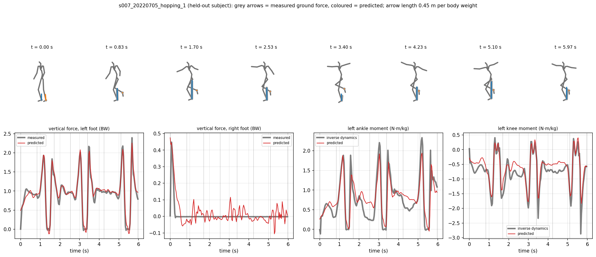
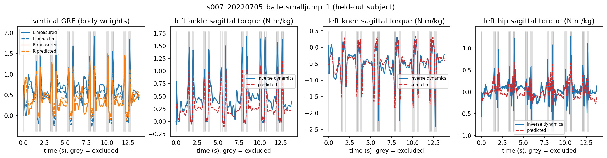
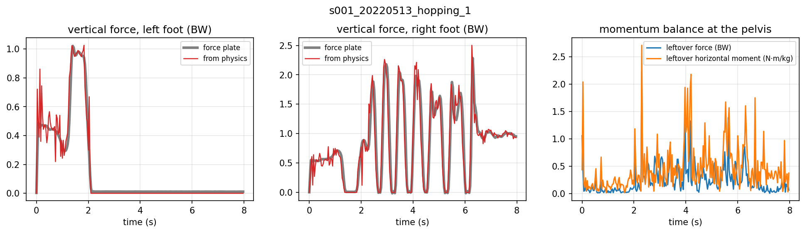

# Learning Joint Torques and Ground Reaction Forces from Human Motion

PyTorch research code for estimating bilateral ground reaction forces and lower-limb joint torques from 3D human motion. The pipeline combines SMPL-H kinematics, force-plate calibration, temporal synchronization, inverse dynamics, temporal convolutional networks, physics-aware objectives, and subject-held-out evaluation.

<p align="center">
  
</p>

## What this project does

The input to the learning model is root-relative 3D motion for 22 body joints. The model receives joint positions and finite-difference velocities, then predicts two 3D ground reaction force vectors and bilateral 3D ankle, knee, and hip moments at every frame.

The complete data path is:

```text
GroundLink force plates + MoSh++ motion fits
                    |
                    v
          SMPL-H body reconstruction
                    |
                    v
      subject and force-plate calibration
                    |
                    v
       force and motion time alignment
                    |
                    v
       filtered recursive inverse dynamics
                    |
                    v
  22-joint position and velocity sequences
                    |
                    v
        dilated Temporal ConvNet
                    |
                    v
       6 GRF + 18 joint-moment values
```

The processed benchmark contains 336 trials from 7 subjects. Across the processed trials, 87.4 percent of frames pass the inverse-dynamics force-consistency filter.

## Held-out subject results

Every subject is held out once. Target normalization is recomputed from the other six subjects inside each fold.

| Model | Vertical GRF RMSE, BW | Ankle RMSE, N m/kg | Knee RMSE, N m/kg | Hip RMSE, N m/kg | Force-balance error, BW |
| --- | ---: | ---: | ---: | ---: | ---: |
| Training mean | 0.322 | 0.286 | 0.415 | 0.425 | 0.312 |
| Single frame | 0.114 | 0.136 | 0.162 | 0.144 | 0.244 |
| Temporal ConvNet | **0.082** | 0.120 | **0.155** | **0.139** | 0.167 |
| Temporal ConvNet + force-balance loss | **0.079** | **0.119** | 0.157 | **0.139** | **0.087** |
| Temporal ConvNet, corruption-trained | 0.107 | 0.148 | 0.197 | 0.170 | 0.192 |

The temporal model reaches mean correlations of 0.904 at the ankle, 0.918 at the knee, and 0.963 at the hip on unseen subjects. It improves vertical GRF and ankle RMSE on all 7 held-out subjects relative to the single-frame model.

The force-balance objective reduces mean force-balance error from 0.167 BW to 0.087 BW. That is a 48 percent reduction, and it lowers vertical GRF error on 6 of 7 held-out subjects without degrading the overall prediction level.

<p align="center">
  
</p>

Grey regions in the example mark frames rejected by the inverse-dynamics validity filter.

## Occlusion and noise robustness

A separate corruption-trained temporal model receives random joint dropout, structured lower-limb dropout, and 3D position noise during training. It gives up some clean-input accuracy in exchange for substantially better failure behavior when joints are missing or noisy.

| Test condition | Standard temporal, GRF RMSE | Corruption-trained, GRF RMSE |
| --- | ---: | ---: |
| Clean | 0.082 BW | 0.107 BW |
| Both feet hidden | 0.331 BW | **0.152 BW** |
| Lower legs hidden | 0.324 BW | **0.219 BW** |
| 25 mm joint noise | 0.351 BW | **0.113 BW** |

With both feet hidden, corruption training cuts vertical-force error by more than half and keeps hip torque RMSE at 0.196 N m/kg instead of 0.398 N m/kg.

## Force and torque architecture study

The architecture ablation tests whether torque prediction improves when force is modeled explicitly.

Across the 7 held-out subjects:

- shared force and torque heads give 0.082 BW vertical GRF RMSE
- a force-then-torque cascade also gives 0.082 BW vertical GRF RMSE and does not improve torque consistently
- a torque-only network is already competitive with the shared model
- measured force as an upper bound improves mean ankle, knee, and hip torque RMSE by about 12.0, 9.9, and 11.7 percent relative to shared heads

The result is that force prediction is useful as an output and as a physics constraint, but feeding force into the torque head is not the main source of torque accuracy.

## Physics and inverse dynamics

Motion is low-pass filtered before differentiation. Whole-body center-of-mass acceleration is compared against measured total ground force, and frames with excessive disagreement are excluded from supervised inverse-dynamics losses.

For each lower limb, recursive Newton-Euler calculations propagate force and moment from the measured foot contact toward the ankle, knee, and hip. Joint moments are normalized by body mass and evaluated in N m/kg.

The force-balance regularizer penalizes disagreement between predicted total ground force and whole-body acceleration:

```text
F_left + F_right = m * (a_COM - g)
```

The implementation works in body-weight normalized force units, so the training residual is divided by gravitational acceleration.

<p align="center">
  
</p>

## SMPL-H calibration and synchronization

Each subject receives a calibrated skeleton scale, body-weight estimate, force-plate assignment, and constant spatial offset between the fitted body and force-plate coordinate system.

Sole contact patches are built from low SMPL-H vertices around the heel and forefoot. Center-of-pressure residuals are then used to align the reconstructed feet to the force plates and to search temporal offsets between motion and force streams.

The completed runs produced subject calibration residuals of about 2.5 to 4.1 cm. Affected recordings required motion-force timing corrections in the approximate range of 0.2 to 1.9 seconds.

## Model architecture

The primary temporal network uses 132 input channels:

```text
22 joints x 3 position coordinates
22 joints x 3 velocity coordinates
```

The backbone contains four residual Conv1d blocks with 256 channels and dilation factors 1, 2, 4, and 8. GroupNorm and GELU are used inside each block. The dynamics head outputs 24 channels per frame:

```text
2 feet x 3 force coordinates = 6
2 legs x 3 joints x 3 moment coordinates = 18
```

Random heading rotation is applied during training so the prediction task does not depend on global yaw.

## Repository layout

```text
motion-dynamics/
  configs/
    default.yaml
  data/
    raw/
      README.md
    interim/
      aligned/
    processed/
      README.md
  checkpoints/
    reference/
      dyn_tcn.pt
      ext_force_balance.pt
      ext_corruption_trained.pt
      tcn_full_novis.pt
      manifest.json
  results/
    figures/
    tables/
  scripts/
    prepare_data.py
    train_loso.py
    run_ablations.py
    evaluate.py
    visualize_trial.py
    inspect_checkpoint.py
  slurm/
    prepare_data.slurm
    train_loso.slurm
  src/motion_dynamics/
    data/
    models/
    physics/
    training/
    evaluation/
    visualization/
  tests/
  pyproject.toml
  requirements.txt
  LICENSE
```

## Data layout

Raw licensed assets are not committed. Place them under:

```text
data/raw/groundlink/force/
data/raw/groundlink/moshpp/
data/raw/body_models/smplh/male/model.npz
data/raw/body_models/smplh/female/model.npz
data/raw/body_models/smplh/neutral/model.npz
```

The completed processed cache can be placed at:

```text
data/processed/groundlink_id_v4.pt
```

The cache is intentionally excluded from Git because it is large and derived from licensed data.

## Setup

```bash
python -m venv .venv
source .venv/bin/activate
pip install -U pip
pip install -e .
```

## Prepare the dataset

```bash
python scripts/prepare_data.py --config configs/default.yaml
```

This stage pairs force and motion trials, reconstructs SMPL-H kinematics, performs subject calibration, aligns force and motion streams, computes inverse-dynamics targets, and writes the processed cache.

## Train leave-one-subject-out models

```bash
python scripts/train_loso.py --config configs/default.yaml
```

The LOSO runner trains the single-frame baseline, temporal model, force-balance model, and corruption-trained model for every held-out subject.

## Run ablations

```bash
python scripts/run_ablations.py --config configs/default.yaml
```

The ablation script covers force and torque coupling, measured-force upper bounds, physics regularization, and input corruption experiments.

## Reference weights

`checkpoints/reference/` contains selected raw `state_dict` files from the completed Compute Canada runs. Their parameter names match the source modules in this repository.

The dynamics reference weights do not contain target normalization statistics. Recompute the target mean and standard deviation from the matching training subjects before physical-unit inference. The LOSO CSV contains the completed fold-by-fold evaluation metrics even though the uploaded result bundle did not contain seven fold-specific checkpoint files.

Inspect a bundled weight file with:

```bash
python scripts/inspect_checkpoint.py checkpoints/reference/dyn_tcn.pt
```

## Result artifacts

The repository includes the exact uploaded result tables used for the summaries above, including:

- `results/tables/loso_all.csv`
- `results/tables/design_comparison.csv`
- `results/tables/inverse_dynamics_summary.csv`
- `results/tables/extensions_clean.csv`
- `results/tables/extensions_occlusion.csv`
- `results/tables/contact_vs_force_plates.csv`
- `results/tables/tracking_conditions.csv`

The optional single-photo experiment is deliberately not presented as benchmark evidence. It has no motion history, unknown camera geometry, and no dynamics ground truth.

## Tests

```bash
pytest -q
```

The tests cover temporal model shapes, physics-loss behavior, SMPL-H rotation math, and compatibility with the bundled reference checkpoints.

## Compute Canada

SLURM examples are included under `slurm/`. Paths are configured through YAML rather than a cluster username. The training code uses CUDA automatically when available.

## License

Copyright 2026. All rights reserved.

This repository is publicly viewable for evaluation and reference only. No permission is granted to copy, modify, redistribute, sublicense, publish, sell, train on, derive from, or reuse the source code or project materials without prior written permission from the copyright holder. See `LICENSE` for the complete terms.
